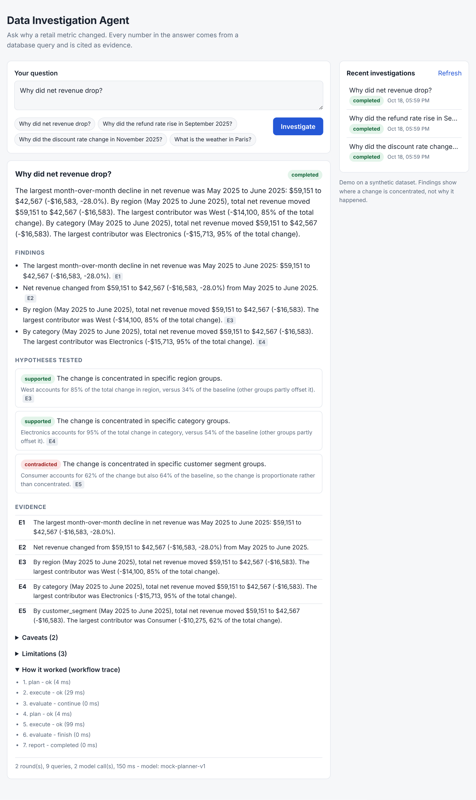
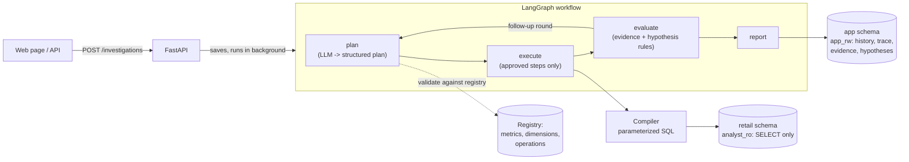

[](https://github.com/asad-ahmad14/data-investigation-agent/actions/workflows/ci.yml)
# Autonomous Data Analyst & Investigation Agent

Ask a business question such as *"Why did net revenue drop?"* and the system investigates it:
an LLM plans the analysis, application code runs it safely against PostgreSQL, and every number
in the answer is traced to numbered evidence.



> Screenshot of the real UI running on the bundled **synthetic** retail dataset in the default
> mock-LLM mode.

## What makes it different from "chat with your database"

- **The model never writes SQL.** It returns a structured plan (Pydantic, strict). The plan is
  validated against a closed registry of metrics, dimensions and operations, compiled into a
  parameterized query by our code, and executed by a **read-only database role**. A model that is
  fooled still cannot name a table, write a statement or reach a column outside the registry.
- **Numbers come from evidence, not from the model.** Results become numbered evidence items
  (E1, E2, ...) with templated descriptions. Findings and hypothesis verdicts cite them.
- **Hypotheses get deterministic verdicts.** A group that is 60% of sales and 62% of a drop is
  *proportionate*, not a cause; the rules (concentration share and disproportion) are documented
  and tested.
- **Bounded and honest.** Limits on rounds, queries, model calls and wall-clock time; failures
  and gaps are reported as caveats; "no data" is never shown as zero.

## How it works



A typical run for *"Why did net revenue drop?"*: round 1 finds **when** (the largest monthly fall,
May to June 2025); round 2 asks **where** (by region, category and segment), then the report says
the drop is concentrated in the West region and the Electronics category and is proportionate
across customer segments.

## Quick start

Requirements: Python 3.12, Docker Desktop (for PostgreSQL).

```bash
git clone <your-repo-url> && cd data-investigation-agent
python3.12 -m venv .venv
source .venv/bin/activate            # Windows PowerShell: .venv\Scripts\Activate.ps1
pip install -e ".[dev]"
cp .env.example .env                 # Windows PowerShell: Copy-Item .env.example .env
# edit .env: set the three passwords (and POSTGRES_PORT if 5432 is taken)

docker compose up -d db              # wait until `docker compose ps` shows "healthy"
alembic upgrade head                 # tables AND the least-privilege roles
python scripts/seed_db.py            # synthetic dataset (safe to rerun)

uvicorn app.main:app --reload        # open http://localhost:8000/
```

No API key is needed: the default `LLM_PROVIDER=mock` is a deterministic rule-based planner that
exercises the same validation path as a real model. To try a real model set `LLM_PROVIDER=gemini`
and `LLM_API_KEY` in `.env` (see *Status* below for what has and has not been verified).

Command line: `python scripts/investigate.py "Why did net revenue drop?" --trace`

## API

| Method | Path | What it does |
| --- | --- | --- |
| POST | `/investigations` | body `{"question": "..."}` -> `202` with an `id`; runs in the background |
| GET | `/investigations/{id}` | status and, when finished, the full report |
| GET | `/investigations/{id}/steps` | the workflow trace |
| GET | `/investigations` | history, newest first (`limit`, `offset`, `status`) |
| GET | `/health`, `/health/ready` | liveness; readiness (database reachable) |

Interactive docs at `/docs` (disabled when `APP_ENV=production`).

## Tests

```bash
ruff check . && ruff format --check .
pytest -m "not integration"          # no database needed
pytest                               # everything; integration tests need the db
```

About 350 tests. Integration tests create and drop their own `<POSTGRES_DB>_test` database and
check results against an independent pandas calculation. The synthetic data has planted patterns
(West disruption in June 2025, Apparel refund spike in September 2025, Home discount promotion in
November 2025), so the right answers are known without trusting the application code. CI runs the
full suite plus a dependency vulnerability audit on every push (see the limitation below).

## Security

Least-privilege database roles, strict plan validation, parameterized queries, a strict
Content-Security-Policy, request size and rate limits, and no secrets in logs. The audit findings,
fixes and **known limitations** (notably: no authentication) are in
[docs/SECURITY.md](docs/SECURITY.md).

## Status and honest limitations

- The dataset is **synthetic**; nothing here was run on real business data.
- Default mode uses a **mock planner**. The Gemini client is tested against mocked HTTP responses
  only and has **not** been run against the live API; the opt-in `real_llm` marker is reserved for
  that. Prompt-injection resistance is structural (strict schema, registry, read-only role) and was
  tested with scripted hostile replies, not measured on a live model.
- Findings describe **where** a change is concentrated, not **why** it happened. Verdict thresholds
  are explainable heuristics, not statistical tests.
- No authentication or TLS; intended for localhost. The rate limiter is per process.
- The `api` service in `docker-compose.yml` / `Dockerfile` has **not been built or run** (Docker was
  not available where this was developed). The supported workflow above runs the API with `uvicorn`
  and only the database in Docker.
- The GitHub Actions workflow in `.github/workflows/ci.yml` has not run on GitHub yet; its install
  and test steps were reproduced locally on a clean virtualenv against PostgreSQL 16.

## Project layout

```
app/
  agent/         LangGraph workflow, evidence, hypothesis rules, report, background runner
  analytics/     plan validator, query compiler, read-only executor, statistics, operations
  api/           FastAPI routes (health, investigations)
  core/          settings, logging, errors, HTTP security
  db/            ORM models (schemas retail + app), engines for the three database roles
  llm/           provider-neutral client, mock and Gemini providers, prompts, structured output
  repositories/  persistence for investigation history (app_rw role)
  retail/        synthetic data generator, seeding, the metric/dimension registry
  schemas/       the structured plan the model is allowed to produce
  web/static/    the web page (plain HTML/CSS/JS, no build step)
migrations/      Alembic: tables, then roles and grants
scripts/         seed_db.py, investigate.py, try_planner.py
docs/            SECURITY.md
tests/           unit, integration and security tests
```

## License

MIT, see [LICENSE](LICENSE).
